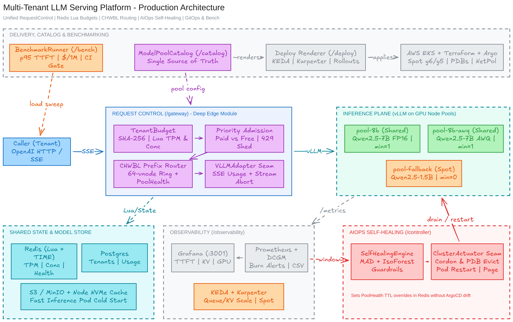
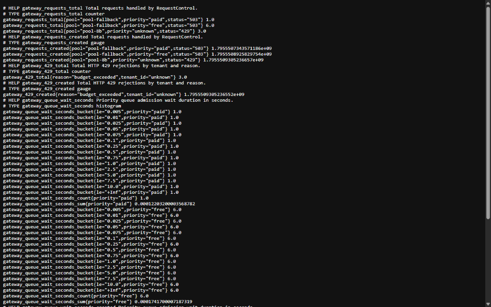
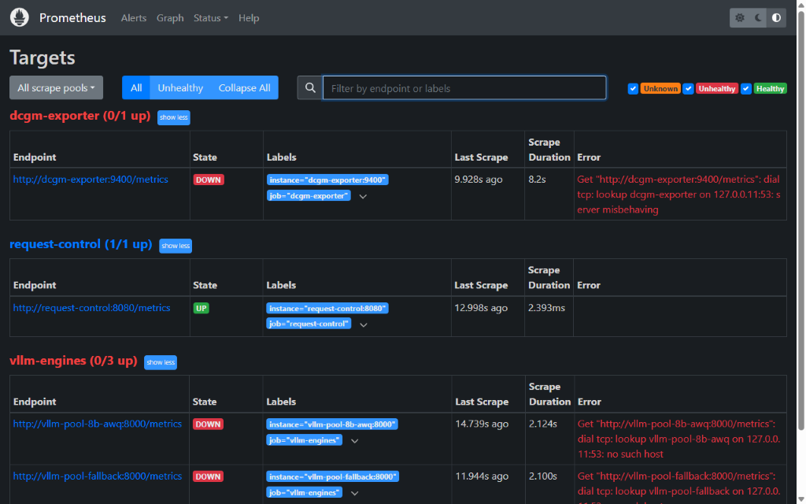
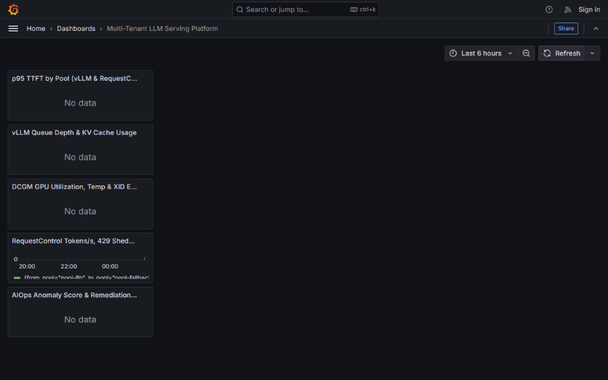

# Multi-Tenant LLM Serving Platform

Kubernetes-native multi-tenant LLM serving platform built around **deep modules with explicit seams**—combining OpenAI-compatible request control, atomic Redis Lua TPM & concurrency enforcement, dynamic multi-tenant LoRA adapter multiplexing, HMAC `cache_salt` prefix-cache isolation, durable Redis Streams → Postgres hourly billing rollups, Prometheus/DCGM/Grafana observability, AIOps self-healing (`MAD` + `IsolationForest`), S3 → RAID0 NVMe weight prefetching, and continuous benchmarking.

## Architecture



> Detailed architecture reference: [docs/ARCHITECTURE.md](docs/ARCHITECTURE.md) · Editable diagram: [docs/architecture.excalidraw](docs/architecture.excalidraw) · Domain language: [GLOSSARY.md](GLOSSARY.md) · ADRs: [docs/adr/](docs/adr/)

### Data, Control, and Delivery Planes

| Plane | Modules | Key Capabilities |
| :--- | :--- | :--- |
| **Model Pool Catalog** | [`catalog/pool_catalog.py`](catalog/pool_catalog.py), [`catalog/pools.yaml`](catalog/pools.yaml) | Single source of truth validating fallback DAGs, `IsolationMode`, `LoraAdapterSpec` (`--enable-lora`, rank/CPU bounds), and prefix-cache isolation flags (`--prefix-caching-hash-algo sha256`). |
| **Request Control Gateway** | [`gateway/request_control.py`](gateway/request_control.py), [`gateway/server.py`](gateway/server.py) | Unified ASGI edge (`POST /v1/chat/completions`, `GET /metrics`): Bearer API key auth, `TenantBudget` reservation & reconciliation, LoRA tenant ownership (`404` + budget refund), caller `cache_salt` stripping + HMAC tenant `cache_salt` injection, local priority queue (`paid` > `free`), tenant/LoRA-salted 64-vnode CHWBL routing, `PoolHealth` fallback, singleflight `/v1/load_lora_adapter` with `404` reload, and shielded SSE disconnect abort. |
| **Budgets, Health & Billing** | [`gateway/tenant_budget.py`](gateway/tenant_budget.py), [`gateway/pool_health.py`](gateway/pool_health.py), [`gateway/usage_rollup.py`](gateway/usage_rollup.py) | Atomic Redis Lua (`HSET` + `EXPIRE` + `TIME`) TPM and `ZSET` concurrency limits with degraded fallback; cross-pod `PoolHealth` TTL overrides; `RedisStreamUsageSink` (`XADD`) + `BillingRollupWorker` (`XREADGROUP` / `XAUTOCLAIM` -> atomic Postgres `usage_event_dedup` + `tenant_usage_hourly` upsert -> post-COMMIT `XACK`). |
| **AIOps Self-Healing** | [`controller/self_healing.py`](controller/self_healing.py) | Iglewicz–Hoaglin MAD Modified Z-Score + `IsolationForest` multivariate scoring on GPU/engine telemetry (`xid_errors`, `ecc_errors`, temp, KV usage, TTFT) with guardrails (`dry_run`, max-1 drain, cooldowns, 2-failure human escalation) behind `ClusterActuator` (`policy/v1` PDB eviction). |
| **Observability** | [`observability/metrics.py`](observability/metrics.py), [`observability/bundle.py`](observability/bundle.py) | `MetricsRegistry` (`/metrics`), background vLLM `/metrics` scraper, multi-window fast/slow SLO burn-rate alerts, pinned DCGM `counters.csv` + DaemonSet, and auto-provisioned Grafana dashboard. |
| **Benchmarking** | [`bench/runner.py`](bench/runner.py), [`bench/cli.py`](bench/cli.py) | Concurrent OpenAI SSE/HTTP load generator measuring p50/p95/p99 TTFT, ITL, E2EL, `goodput_rps`, `$ / 1M tokens`, and CI baseline regression gating. |
| **GitOps & Prefetch** | [`deploy/manifest_renderer.py`](deploy/manifest_renderer.py), [`deploy/terraform/`](deploy/terraform/main.tf) | Renders KEDA `ScaledObject`s, `vllm/vllm-openai:v0.9.0` Deployments (`wait-model-weights` `initContainer`, `--model /models/<slug>`), `daemonset-weight-prefetch.yaml` (`s5cmd` + `flock` + atomic swap), `NetworkPolicy`, Karpenter `NodePool`/`EC2NodeClass` (`instanceStorePolicy: RAID0`), and Argo `Rollout` + `AnalysisTemplate`. |

### Request Lifecycle (`RequestControl`)

```text
Caller ─▶ RequestControl (/gateway)
            ├─ Auth + TenantBudget Reservation (SHA-256 API Key -> Redis Lua TPM + ZSET Concurrency)
            ├─ Target & LoRA Authorization (ModelPoolCatalog.resolve_target; 404 + Permit refund on mismatch)
            ├─ Local Priority Admission (paid before free; 429 Retry-After shedding)
            ├─ CHWBL Prefix Router (64-vnode ring salted by tenant_id + lora_name) + PoolHealth Fallback
            ├─ Cache Isolation + Dynamic LoRA (strip caller cache_salt -> inject HMAC salt; /v1/load_lora_adapter)
            ├─ VLLMAdapter (OpenAI HTTP/SSE, shielded disconnect abort, 503 + Permit refund on upstream error)
            └─ Usage Reconciliation ─▶ Redis Streams (XADD) ─▶ Postgres Billing Rollup (XAUTOCLAIM + XACK)
```

---

## Live Output & Screenshots

### 1. Request Control Prometheus Metrics (`http://localhost:8080/metrics`)
Live `gateway_requests_total` (`429`, `503`), `gateway_429_total` (`budget_exceeded`), and `gateway_queue_wait_seconds` histogram buckets captured from the running gateway container:



### 2. Prometheus Scrape Targets (`http://localhost:9090/targets`)
Prometheus scraping `http://request-control:8080/metrics` (`UP`, ~2.4ms scrape duration), alongside GPU-only `vllm-engines` and `dcgm-exporter` targets (down on CPU-only host when the optional `gpu` Compose profile is inactive):



### 3. Grafana Dashboard (`http://localhost:3001`)
Auto-provisioned `Multi-Tenant LLM Serving Platform` dashboard plotting live fallback routing telemetry (`from_pool="pool-8b"` -> `to_pool="pool-fallback"`) queried from Prometheus:



### Verified Test & Static Analysis Output

```text
$ python -m pytest -v
43 passed in 2.69s

$ python -m mypy .
Success: no issues found in 28 source files

$ python -m ruff check .
All checks passed!
```

---

## Quickstart (Local Verification)

```bash
# 1. Install dependencies and run unit & seam tests, typechecking, and lint
pip install -e .
python -m pytest -v
python -m mypy .
python -m ruff check .

# 2. Render Kubernetes, KEDA, Karpenter, Weight Prefetch DaemonSet, and Observability manifests
python -m deploy.render_all --catalog catalog/pools.yaml --out-dir deploy/generated --use-prefetched-weights

# 3. Boot RequestControl + Redis + Prometheus + Grafana (add --profile gpu on an NVIDIA host)
docker compose up --build -d
```

## Billing Worker & Benchmarking CLIs

```bash
# Run the Redis Streams -> Postgres hourly billing rollup consumer
REDIS_URL=redis://localhost:6379/0 DATABASE_URL=postgresql://... python -m gateway.usage_rollup

# Record benchmark baseline / A-B arm with $/1M tokens and SLO gate (p95 TTFT <= 1000ms)
python -m bench.cli \
  --name prefix-on-awq \
  --base-url http://127.0.0.1:8080 \
  --api-key sk-paid-demo \
  --model qwen-7b-awq \
  --num-requests 100 \
  --concurrency 8 \
  --gpu-hourly-usd 0.44 \
  --out-json bench/results/prefix-on-awq.json
```
