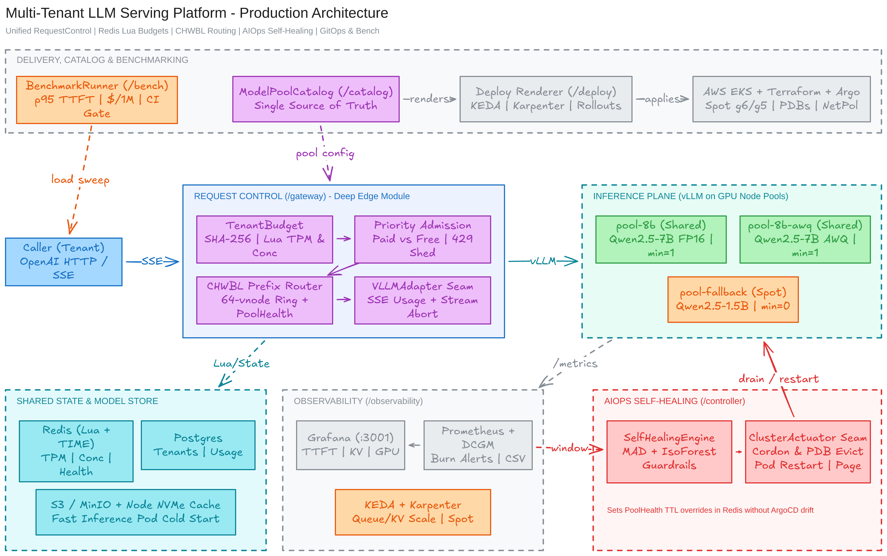

# Multi-Tenant LLM Serving Platform — Architecture

Editable Excalidraw source: [architecture.excalidraw](./architecture.excalidraw) · Domain language: [GLOSSARY.md](../GLOSSARY.md) · Decisions: [docs/adr/](./adr/)

---

## 1. Overview

A Kubernetes-based multi-tenant LLM serving platform designed around **deep modules with explicit seams** so every core behavior—token budgeting, priority admission, prefix-cache routing, SSE disconnect cancellation, self-healing guardrails, and benchmark gating—runs and tests deterministically before and during GPU cluster execution.

| Plane | Modules & Files | Responsibility |
| :--- | :--- | :--- |
| **Catalog (Source of Truth)** | [`catalog/pool_catalog.py`](../catalog/pool_catalog.py), [`catalog/pools.yaml`](../catalog/pools.yaml) | Validates pool invariants, fallback DAG, `LoraAdapterSpec` multiplexing (`--enable-lora`, rank/CPU caps), prefix-cache isolation flags, and renders downstream configs for Request Control, KEDA, Rollouts, NVMe prefetch, and `vllm` CLI args. |
| **Request Control** | [`gateway/request_control.py`](../gateway/request_control.py), [`gateway/server.py`](../gateway/server.py) | Single Starlette/ASGI module uniting Bearer API key auth, `TenantBudget`, LoRA tenant authorization & dynamic adapter loading (`/v1/load_lora_adapter`), HMAC `cache_salt` stripping/injection, local priority admission, tenant-salted CHWBL prefix routing, `PoolHealth` fallback, SSE streaming, and disconnect abort. |
| **Tenant Budget, Health & Billing** | [`gateway/tenant_budget.py`](../gateway/tenant_budget.py), [`gateway/pool_health.py`](../gateway/pool_health.py), [`gateway/usage_rollup.py`](../gateway/usage_rollup.py) | Atomic Redis Lua (`HSET` + `EXPIRE` + `redis.call('TIME')`) TPM and `ZSET` concurrency permits with degraded fallback; cross-pod TTL-bounded `PoolHealth` overrides; `RedisStreamUsageSink` (`XADD`) and `BillingRollupWorker` (`XREADGROUP`/`XAUTOCLAIM` -> transactional Postgres `usage_event_dedup` + `tenant_usage_hourly` -> post-COMMIT `XACK`). |
| **AIOps Self-Healing** | [`controller/self_healing.py`](../controller/self_healing.py) | Pure `SelfHealingEngine` combining Iglewicz–Hoaglin MAD Modified Z-Score + `IsolationForest` scoring with guardrails (`dry_run`, max-1-node drain, cooldowns, 2-failure paging) behind a `ClusterActuator` seam. |
| **Observability** | [`observability/metrics.py`](../observability/metrics.py), [`observability/bundle.py`](../observability/bundle.py) | Isolated Prometheus `MetricsRegistry` (`/metrics`), periodic `VLLMAdapter.scrape_metrics()` lifespan loop, multi-window burn-rate alerts, pinned DCGM `counters.csv` DaemonSet, and Grafana dashboard JSON. |
| **Benchmarking** | [`bench/runner.py`](../bench/runner.py), [`bench/cli.py`](../bench/cli.py) | Concurrent OpenAI HTTP/SSE load driver measuring p50/p95/p99 TTFT/ITL/E2EL, `goodput_rps`, output & blended `$/1M tokens`, typed `ArmComparison`, and CI baseline regression gating. |
| **Delivery & GitOps** | [`deploy/manifest_renderer.py`](../deploy/manifest_renderer.py), [`deploy/terraform/`](../deploy/terraform/main.tf), [`docker-compose.yml`](../docker-compose.yml) | Renders KEDA `ScaledObject`s, vLLM `Deployment`s, `PodDisruptionBudget`s, `NetworkPolicy`, Karpenter `NodePool`/`EC2NodeClass`, Argo `Service`/`Rollout`/`AnalysisTemplate`, plus Terraform EKS/S3 and local Docker Compose. |

---

## 2. Request Lifecycle (`RequestControl`)

1. **Schema, Target & LoRA Resolution:** Validates the OpenAI `/v1/chat/completions` payload (`ConfigDict(extra="allow")`, returning OpenAI-formatted `400 invalid_request_error` on malformed JSON/schemas) and resolves base pool aliases or `LoraAdapterSpec` targets via `ModelPoolCatalog.resolve_target`.
2. **Authentication, LoRA Ownership & `Permit` Reservation (`TenantBudget`):** Hashes the Bearer `API Key` with SHA-256, looks up `TenantRecord`, atomically reserves `est_prompt + max_tokens` and a `ZSET` concurrency slot via `_RESERVE_LUA`, and enforces per-tenant `lora.tenant_id` ownership (`404` + budget refund on mismatch).
3. **In-Process Priority Admission:** Local priority heap (`paid` before `free`) checks expected queue wait against tier budgets, shedding excess `free` traffic with `429` + `Retry-After` and cancelling safely without leaking `Permit`s or `_in_flight` slots on disconnect.
4. **CHWBL Prefix Routing, `cache_salt` Isolation & Dynamic LoRA Load:** Selects a `HEALTHY` pool (blocking incompatible base fallback with `503` for LoRA targets). `_pick_replica` uses a 64-vnode consistent hash ring salted by `tenant_id` (when `isolate_prefix_cache` is true) and `lora_name`. Before dispatch, Request Control strips any caller-supplied `cache_salt`, injects an HMAC-SHA256 `(CACHE_SALT_SECRET, tenant_id)` `cache_salt`, and calls `VLLMAdapter.ensure_lora_loaded` (`/v1/load_lora_adapter` once per replica/adapter).
5. **Streaming, Disconnect Abort & Durable Billing:** `VLLMAdapter` requests `stream_options: {"include_usage": True}`, passes OpenAI SSE chunks cleanly, and closes the upstream stream inside `anyio.CancelScope(shield=True)` on disconnect. Unused tokens/concurrency are reconciled and emitted as a `UsageEvent` into `RedisStreamUsageSink` for idempotent hourly Postgres rollups by `BillingRollupWorker`.

---

## 3. Seams & Adapters (Testability & Portability)

| Seam | Production Adapter | Deterministic Test Adapter | Purpose |
| :--- | :--- | :--- | :--- |
| `InferenceEngine` | `VLLMAdapter` (`httpx` + `/metrics`) | `FakeEngineAdapter` | Decouples `RequestControl` HTTP/SSE/routing tests from live GPU pods. |
| `BudgetAdapter` | `RedisPostgresAdapter` (`Lua` + `TIME`) | `InMemoryBudgetAdapter` (`fakeredis` also tested) | Encapsulates Redis failure degradation and atomic bucket math. |
| `PoolHealth` | `RedisPoolHealthAdapter` (atomic Lua) | `PoolHealthStore` | Shares slow-path `DEGRADED` TTL overrides across pods without ArgoCD drift. |
| `ClusterActuator` | `K8sActuatorAdapter` (`policy/v1` Eviction + `429` retry) | `SimulatedActuatorAdapter` | Tests full anomaly-to-drain/restart/escalation guardrails in milliseconds. |

---

## 4. AIOps Control Loop & Guardrails (`SelfHealingEngine`)

- **Univariate + Multivariate Scoring:** Computes Iglewicz–Hoaglin MAD Modified Z-Score on `ttft_ms_series` (immune to jitter and baseline outliers) and optional `IsolationForest` scoring on `TelemetryFeature(ttft_ms, kv_cache_usage, gpu_temp_c)`.
- **Signal → Action Mapping:**
  - `xid_errors > 0`, `ecc_errors > 0`, or `gpu_temp_c >= 85.0` → `CORDON_AND_DRAIN` via `ClusterActuator` (cordon + `policy/v1` Eviction respecting PDBs, skipping DaemonSets).
  - `kv_cache_usage >= 0.95` or `oom_restarts > 0` (or joint anomaly) → `MARK_POOL_DEGRADED` via `PoolHealth` TTL override + `RESTART_POD` (without mutating ArgoCD-managed Deployment args).
- **Guardrails:** `dry_run` mode, action deduplication, per-target cooldowns, at most 1 concurrent draining node (`complete_drain()` to release), structured `AuditEntry` log, and `ESCALATE_TO_HUMAN` (`page_human`) after 2 consecutive failures.

---

## 5. Observability, Delivery & Benchmarking

- **Metrics & Alerts:** `RequestControl` exposes `GET /metrics` (9 Prometheus metrics covering requests, 429s, queue wait, streaming TTFT, E2EL, fallbacks, tokens, anomaly scores, and remediation actions) and polls vLLM `/metrics` in its ASGI lifespan. `render_observability_bundle` generates multi-window fast/slow burn-rate alerts, explicit DCGM `counters.csv` + pinned `DaemonSet`, and Grafana dashboard JSON.
- **Deploy & GitOps:** `render_deploy_manifests` emits KEDA `ScaledObject`s (`vllm:num_requests_waiting`, `vllm:kv_cache_usage_perc`, `activationThreshold` for scale-to-zero), `vllm/vllm-openai:v0.9.0` `Deployment`s (`/dev/shm`, `VLLM_ALLOW_RUNTIME_LORA_UPDATING=true`, `--prefix-caching-hash-algo sha256`, optional `wait-model-weights` `initContainer` + `--model /models/<slug>`), `daemonset-weight-prefetch.yaml` (`s5cmd` + `flock` + `.ready`), `NetworkPolicy`, Karpenter `g6`/`g5` `NodePool`/`EC2NodeClass` (`instanceStorePolicy: RAID0`), and Argo `Rollout` + `AnalysisTemplate`.
- **Execution Status & Roadmap:** Local CPU Docker Compose (`request-control`, `redis`, `prometheus`, `grafana`) and 40 unit/seam tests pass locally. GPU benchmarking (`bench/cli.py`), live spot-GPU A/B runs, and full EKS/Karpenter deployment follow the runbook in [end-to-end-gpu-execution-plan.md](./research/end-to-end-gpu-execution-plan.md).

---

## 6. Architecture Decisions (ADRs)

1. [0001: Collapse Gateway, Admission, and Router into Request Control](./adr/0001-request-control-single-module.md)
2. [0002: Separate Fast-Path Routing from Slow-Path Remediation via Pool Health](./adr/0002-pool-health-ownership.md)
3. [0003: Encapsulate Redis Outage Degradation in Tenant Budget and Keep Queues Local](./adr/0003-tenant-budget-and-local-queues.md)
4. [0004: Co-Locate Anomaly Scoring and Remediation Policy Behind Cluster Actuator](./adr/0004-self-healing-actuator-seam.md)
5. [0005: Centralize Model Pool Configuration in Model Pool Catalog](./adr/0005-model-pool-catalog.md)
